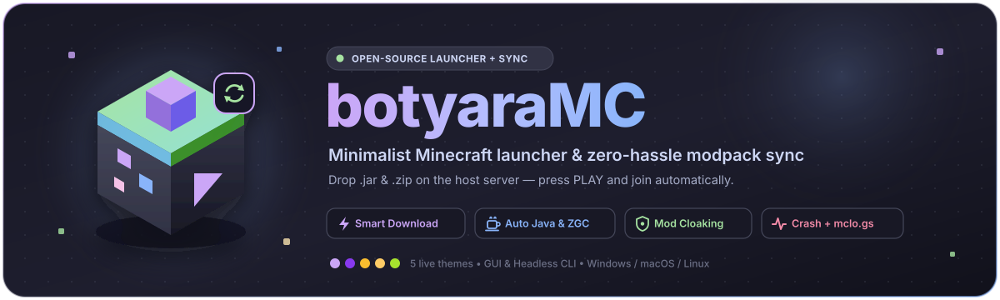

<div align="center">



<br/>

[](https://github.com/dimasbotyara/botyaraMC/actions/workflows/tests.yml)
[](https://www.python.org/)
[](#-features)
[](#-quick-start)
[](https://mclo.gs)
[](LICENSE)

<p>
  <strong>🇬🇧 English</strong> &nbsp;·&nbsp; <a href="README.ru.md">🇷🇺 Русский</a>
</p>

</div>

---

## ✨ What is botyaraMC?

**botyaraMC** is a clean, lightweight, zero-bloat Minecraft launcher paired with a self-hosted Python sync server — built specifically for playing modded Minecraft with friends over **Radmin VPN**, **Tailscale**, **ZeroTier**, or **LAN**.

No more sending 400 MB `.zip` archives on Discord/Telegram every time you add or remove a mod:
1. **The Host** drops `.jar` mods into `server/mods/` and `.zip` packs into `server/resourcepacks/`.
2. **Friends** press **`▶ PLAY`** — the launcher auto-discovers the host over UDP, resumes any interrupted downloads via HTTP `Range`, verifies `SHA-256` checksums, installs the right Minecraft version, loader & Java runtime, and connects straight into the server.

---

## 🔥 Features

### 📦 Smart Sync & Server-Side Mod Cloaking
- **Upfront Download Size Preview** — Before launching, the Play button displays the exact remaining download size (e.g. `▶ PLAY • Download 45 MB`) along with live MB progress.
- **Resumable Downloads (`HTTP Range`)** — Interrupted transfers keep their `.part` state and resume from the exact byte via `206 Partial Content`, verified end-to-end with `SHA-256`.
- **Non-Destructive Mod & Resourcepack Sync**:
  - Client-side personal mods (minimap, shaders, QoL) are **never touched** — the launcher only removes obsolete mods it installed itself (`managed.json`).
  - Resourcepacks (`server/resourcepacks/*.zip`) sync strictly in **add-only** mode — existing user resourcepacks are never overwritten or deleted.
- **Server-Side Mod Obfuscation (`hide_mods`)** — Want to keep secret content or anti-cheat mods a surprise? Obfuscate filenames on the fly using random word slugs (`silent-amber-otter-42.jar`) or salted HMAC hashes (`mod_7f3a9c12e4b08d51.jar`), globally or for selected `.jar` files only. Direct requests to original filenames return `404`.
- **Offline Fallback** — If the sync server is temporarily unreachable, the game launches seamlessly from the last cached manifest.

### ☕ Java, Memory & JVM Tuning
- **Java Auto-Detection & Manual Override** — Automatically scans Windows, macOS, and Linux for installed JDKs/JREs (Temurin, Zulu, Liberica, GraalVM, Oracle, OpenJDK, Mojang Runtimes), respects optional `java_version` requirements from the sync server, or downloads the official Mojang runtime automatically.
- **JVM Presets & Custom Flags Editor** — Built-in **`G1GC`**, **`Aikar's Flags`**, **`ZGC`** (auto-enables `-XX:+ZGenerational` on Java 21–22 and safely falls back to G1GC on Java < 17), and **`Minimal`**, plus an interactive editor to create/modify presets and append extra JVM arguments.
- **Auto-RAM & Manual Slider** — Smart system memory detection via `psutil` for optimal GC pause times, or manual MB slider + exact numeric input.

### 🖥️ Desktop UX & Crash Diagnostics
- **5 Instant Live Themes** — *Catppuccin Mocha*, *Catppuccin Latte*, *Gruvbox*, *Ayu (Mirage)*, and *Monokai* — recoloring every widget live without restarting.
- **Window & Resolution Controls** — Default window, `--fullscreen`, or custom `Width × Height` with one-click presets (`1280×720`, `1600×900`, `1920×1080`, `2560×1440`).
- **Quick Folder Opener (`📂`)** — One-click (or `1–6` number keys) access to `.minecraft`, `mods`, `resourcepacks`, `screenshots`, `crash-reports`, and launcher config/logs.
- **Startup Watchdog Timeout** — Detects frozen launches if LWJGL/OpenAL fails to initialize within the configured timeout and terminates hung processes cleanly.
- **Built-in Crash Report Parser + [mclo.gs](https://mclo.gs/) Sharing** — Automatically analyzes `game.log`, `crash-reports/crash-*.txt`, and `hs_err_pid*.log` (`OutOfMemoryError`, Java classfile version mismatches, Fabric/Forge mod conflicts, Mixin errors, OpenGL/GPU driver crashes) and opens a full log viewer with **Copy**, **Share to mclo.gs** (with automatic OS username & token scrubbing), **Restart**, and **Close**.

### 🤖 Headless CLI Mode
- Launch synchronization and Minecraft directly from scripts, shortcuts, or `systemd` services with **zero GUI overhead** (`python main.py --play --nick Steve`).

---

## 🗂 Repository Structure

```text
botyaraMC/
├── assets/                    # Vector & Retina banner + window icon
├── server/                    # Runs on the host machine (stdlib Python only!)
│   ├── server.py              # Multi-threaded HTTP server (with HTTP Range 206 support)
│   ├── srv_config.py          # Auto-generated config.txt parser & live reload
│   ├── mods_index.py          # SHA-256 indexer + words/hash mod name obfuscator
│   ├── discovery.py           # UDP broadcast responder (LAN & Radmin VPN)
│   ├── mods/                  # Drop server/modpack .jar files here
│   └── resourcepacks/         # Drop .zip resourcepacks here
├── launcher/                  # Distributed to friends
│   ├── main.py                # Entry point (routes to GUI or zero-Tk CLI)
│   ├── ui.py / themes.py      # CustomTkinter interface, dialogs, hotkeys & themes
│   ├── sync.py                # Download planner, HTTP Range resume & SHA-256 sync
│   ├── mc.py / jvm.py         # Version/loader installer, Java scanner & JVM presets
│   ├── crash.py               # Crash analyzer & mclo.gs v1 JSON API client
│   ├── cli.py / config.py / discovery.py
│   └── requirements.txt
└── tests/                     # End-to-end pytest suite (Server + Sync + CLI + GUI)
```

---

## 🚀 Quick Start

### 1. Sync Server (Host)

Requires only **Python 3.10+** (zero third-party packages needed on the server):

```bash
cd server
python server.py
```

On first run, `config.txt`, `mods/`, and `resourcepacks/` are created automatically. Allow **TCP `25456`** (HTTP sync) and **UDP `25457`** (auto-discovery) in your firewall.

#### `server/config.txt` Reference

All settings except ports reload **live on the fly** without restarting `server.py`:

| Key | Default | Description |
|---|---|---|
| `http_port` | `25456` | TCP port serving `/manifest`, `/mods/*`, and `/resourcepacks/*` |
| `discovery_port` | `25457` | UDP port for automatic LAN / Radmin VPN discovery |
| `mc_version` | `1.20.1` | Target Minecraft version installed & launched on clients |
| `loader` | `fabric` | Mod loader: `fabric`, `forge`, `neoforge`, `quilt`, or `none` |
| `java_version` | `auto` | Required major Java version (`auto`, `8`, `17`, `21`, etc.) |
| `hide_mods` | `none` | Mod filename cloaking: `none`, `words` (`silent-amber-otter-42.jar`), or `hash` (`mod_7f3a9c12e4b08d51.jar`) |
| `hide_mods_list` | *(empty)* | Optional comma-separated `.jar` list to cloak selectively (empty = cloak all mods when `hide_mods` is enabled) |
| `minecraft_server` | `127.0.0.1` | Minecraft server IP for automatic multiplayer join (e.g. your Radmin VPN IP `26.x.x.x`) |
| `minecraft_port` | `25565` | Minecraft server port (make sure `online-mode=false` is set in `server.properties`) |

---

### 2. Launcher (Players)

```bash
cd launcher
pip install -r requirements.txt
python main.py
```

On first launch, a 3-step setup wizard asks for your **nickname**, **theme** (with live preview), and **sync server IP** (with one-click **Auto-Find** over UDP).

> **Host Tip:** Enable **👑 Host Mode** in `⚙ Settings` and point it to your Minecraft server's `mods/` folder — the launcher will keep both your client `.minecraft/mods` and server `mods/` in sync simultaneously.

---

## 🤖 CLI Mode & Automation

Run `botyaraMC` headlessly without importing Tkinter — ideal for shell scripts, custom shortcuts, kiosk setups, and `systemd` user units:

```bash
cd launcher

# Sync mods + resourcepacks and launch immediately:
python main.py --play --nick Steve

# Full custom launch (server override, Auto-RAM, Aikar's Flags, fullscreen, auto-upload crash to mclo.gs):
python main.py --play --nick Steve --server 26.12.34.56 --auto-ram --jvm-preset "Aikar's Flags" --fullscreen --share-crash

# Pre-warm / sync modpack & install MC version without launching the game (works on headless servers without X11!):
python main.py --sync-only --server 26.12.34.56

# List all Java installations detected on the machine:
python main.py --detect-java
```

<details>
<summary><strong>📋 Example <code>systemd</code> User Unit (<code>~/.config/systemd/user/botyaramc.service</code>)</strong></summary>

```ini
[Unit]
Description=botyaraMC Auto-Sync & Launch
After=network-online.target

[Service]
Type=simple
WorkingDirectory=%h/botyaraMC/launcher
ExecStart=/usr/bin/python3 main.py --play --nick Steve --auto-ram --share-crash
Restart=on-failure
RestartSec=10

[Install]
WantedBy=default.target
```

`botyaraMC` forwards `SIGTERM` and `SIGINT` cleanly to the child JVM process on `systemctl --user stop botyaramc`.

</details>

---

## ⌨️ Keyboard Shortcuts

| Shortcut | Action |
|---|---|
| `Enter` / `Ctrl + P` | Launch Minecraft (from main screen) |
| `F5` / `Ctrl + R` | Refresh server manifest & recalculate download size |
| `Ctrl + O` | Open quick folder selector (`1–6` keys inside) |
| `Ctrl + L` | Open latest game log viewer (`game.log`) |
| `Ctrl + ,` | Open `⚙ Settings` |
| `Ctrl + S` | Save changes in `⚙ Settings` |
| `Esc` | Close active dialog / leave Settings without saving |
| `F1` | Show keyboard shortcuts cheat sheet |

---

## 🎨 Themes

| Theme | Mode | Background | Accent |
|---|---|---|---|
| **Catppuccin Mocha** *(default)* | Dark | `#1e1e2e` | `#cba6f7` |
| **Catppuccin Latte** | Light | `#eff1f5` | `#8839ef` |
| **Gruvbox** | Dark | `#282828` | `#fabd2f` |
| **Ayu** | Dark | `#1f2430` | `#ffcc66` |
| **Monokai** | Dark | `#272822` | `#a6e22e` |

---

## 🧪 Running Tests

The test suite covers the HTTP Range sync server, mid-stream disconnect recovery, mod cloaking (`words`, `hash`, selective), non-destructive resourcepack sync, Java detection, JVM presets, launch timeout watchdog, crash report parser, `mclo.gs` privacy scrubbing, headless CLI, and CustomTkinter UI views:

```bash
pip install -r launcher/requirements.txt pytest
pytest -v
```

---

## 📄 License

Released under the [MIT License](LICENSE) © [dimasbotyara](https://github.com/dimasbotyara).
